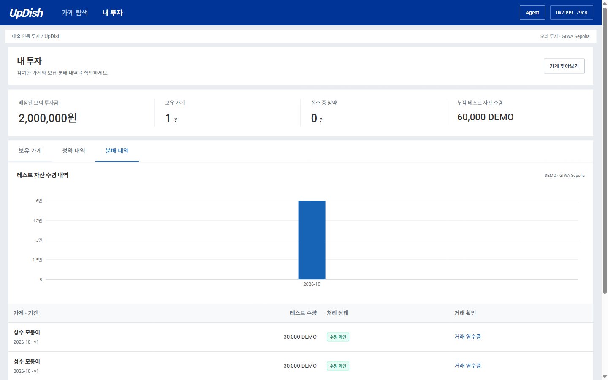

# 로그인부터 분배까지 흐름 점검 — 2026-10-31

대상은 현재 업비트 참고 디자인의 발표 v0.3다. Web → Core → PostgreSQL → 계약 → 수령 화면을 연결해서 확인했다. 사용자의 실제 GIWA 서명 결과는 [최종 지갑 리허설 이슈](https://github.com/UpDish/updish/issues/2)에 따로 기록한다.

## 별도 환경에서 확인한 흐름

| 단계 | 확인 결과 |
| --- | --- |
| 로그인·가게 선택 | 표준 지갑 선택과 실제 로컬 SIWE, 두 투자 탭, 가게 상세, 본점 참고/2호점 승인 구분 |
| 청약·배정 | 100만원 → 100단위 → 위험 확인 → 접수 → 운영자 배정. 배정 전 보유 0, 배정 후 100 |
| 매출 대조 | 정상 CSV 제출, 3,100만원 매출에서 할인·환불 100만원 제외, PG·입금 3,000만원 일치, 중복 제외 |
| 검토·승인 | 제출자와 다른 지갑이 마감, 산정자와 다른 지갑이 승인. 자체 승인과 타인의 명세 조회는 거부 |
| 계약·분배 | 네 컴파일 계약 배포·서버 검증, 수량 발행·매출 기록, 정확한 DEMO 사용 승인·예치·분배 |
| 수령·정정 | 투자자 실제 로컬 ERC-20 잔고 +30,000 DEMO와 개인 영수증, 중복 방지. 매출 2,900만원으로 정정해도 과거 수령 유지·추가 분배 차단 |

[HTTP·계약 검사](evidence/full-flow-20261031/http-contracts.json) 7개와 확인된 작업 영수증 8개, [투자 UI](evidence/full-flow-20261031/browser-investor.json) 12개, [전체 분배 UI](evidence/full-flow-20261031/browser-distribution.json) 12개를 통과했다. 브라우저 실행 오류는 0건이다. 전용 DB/Anvil·로컬 지갑·mock Dojang 결과이며 GIWA 거래가 아니다.

과거 실행을 유지하므로 로컬 수령 화면에는 별도 HTTP 검사와 UI 검사의 각각 30,000 DEMO가 함께 표시될 수 있다. 같은 가게가 두 번 집계되거나 하나의 실제 GIWA 분배라고 해석하지 않는다.

## 발견하고 고친 부분

- 리허설 시작 스크립트가 Agent를 띄우지 않아 채팅 입력이 비활성화됐다. 이제 Agent 8000도 함께 시작하고 기존 승인 키를 해당 프로세스에서만 불러온다. 기존 Agent가 있으면 서비스 확인 후 재사용하고 다른 프로그램은 덮어쓰지 않는다. [새 시작 절차 결과](evidence/full-flow-20261031/startup.json).
- 계정 전환 후 이미 열린 로그인 팝업 위에서 자동검사기가 시작 버튼을 다시 누르려 했다. 기존 팝업을 이어 쓰도록 검사기를 수정했고 전체 분배 UI가 통과했다.
- DEMO 토큰은 다른 계약을 참조하지 않는데 수량·기록 계약 등록 전 배포가 막혀 있었다. 해당 선행 조건을 없애서 두 계약의 safe 확정을 기다리는 동안 먼저 배포할 수 있게 했다. 분배 계약의 선행 계약 검증과 서버의 safe 검증은 유지한다. 변경 후 production build가 통과했으며 공개 지갑 결과는 위 이슈에 기록한다.
- 실제 GIWA에서는 새 거래의 영수증이 먼저 보이고 해당 블록 조회가 잠시 비어 있는 경우가 있었다. 같은 해시 재대조로 블록 포함을 확인했다. 이미 제출된 현재 run의 거래만 활성 화면에서 30초마다 재대조하며 SAFE/실패 후 멈춘다. 새 거래 준비·송신·재시도는 자동화하지 않는다. 각 배포 영수증 링크와 요청할 거래 종류를 화면에 표시하고, 계약 등록 후의 준비 가능 상태와 노드 조회 대기도 구분한다.
- 공개 Agent가 원화 의무액 30,000원을 생략했고, 첫 수정 후에는 실제 근거에서 매출 30,000,000원을 의무액 30,000원과 혼동했다. 최종 구현은 의무·safe 수령·추가 DEMO·총매출·할인·환불·정산대상 매출·전체 배분금·보유 단위를 승인 원장 필드에서 직접 형식화한다. 모델은 숫자 없는 의미·정책 설명을 생성하며 숫자나 한글 수사로 금액을 다시 쓰면 답변을 거부한다. 현금 부족·기존 수령 초과·확정 대기 여부는 정성적 근거로 유지하고 이전 캐시는 새 버전으로 대체한다. [최종 회귀 검사](evidence/full-flow-20261031/agent-ledger-validation.json)와 [실제 모델 가상 근거 응답](evidence/full-flow-20261031/agent-ledger-model.json)을 통과했다. 초기 [검사](evidence/full-flow-20261031/agent-facts-validation.json)·[응답](evidence/full-flow-20261031/agent-facts-model.json)은 이전 시도로 보관한다. 모델 가상 근거 검사는 GIWA 거래나 실제 수령의 증거가 아니다.

## 실제 GIWA 시연

공개 화면에서 운영/검토 두 실제 계정의 SIWE, 운영 지갑의 유효한 TESTNET FAUCET Dojang, 100단위 청약·배정, 별도 검토 지갑의 CSV 마감·정산 산정을 확인했다. 온체인 배포·발행·분배는 사용자가 지갑에서 서명한다.

2026-11-01 00:19 KST 읽기 검사에서 사용자가 서명한 **GIWA 거래 8개 모두 canonical/safe**를 확인했다. [실제 거래·승인 금액·분배 계약 상태](evidence/full-flow-20261031/giwa-before-distribution.json)는 로컬 검사와 별도 증거다.

| 단계 | 실제 GIWA 결과 |
| --- | --- |
| 계약 배포·등록 | 수량 `0x7608…7fbd`, 기록 `0xbbc1…8934`, DEMO `0xf067…5812`, 분배 `0x4709…9ff9` 네 계약 safe 및 서버 등록 완료 |
| 보유 수량 | 사용자 100단위 발행 safe, DB·체인 모두 100. 가상 배경 9,900단위는 체인 발행·송금 제외 |
| 승인 정산 기록 | 승인 digest와 온체인 기록 일치, registry 거래 safe |
| DEMO 사용 승인 | 정확히 3,000,000 DEMO 승인. 예치 후 남은 allowance 0 |
| 재원 예치 | 분배 계약 3,000,000 DEMO 보유, 예치 거래 safe, 현재 지급 0 |
| 개인 분배·수령 | **사용자의 마지막 30,000 DEMO 분배 서명 대기.** 아직 거래 해시·safe 수령 영수증이 없어 완료로 표시하지 않음 |

원화 의무액 30,000원과 테스트 자산 수령량은 별개다. 분배가 완료되면 예치 직후의 사용자 잔고에서 30,000 DEMO가 증가하고 분배 계약에는 가상 배경 몫 2,970,000 DEMO가 남아야 한다. 전체 3,000,000 DEMO를 모두 지급한 것으로 해석하지 않는다. 실제 GIWA 하향 정정은 이번에 실행하지 않았고, 위 로컬 정정 결과와 구분한다.

수정본 `d758a72`는 Vercel production READY 및 기존 EC2 Core/Agent에 반영했다. 백업·기존 업무 행 수·active run·V9·빌드 해시·환경 파일 0600을 확인했다. [배포 근거](evidence/full-flow-20261031/release-20261101.json). 공개 상담의 실제 모델 응답도 [배포 후 검사](evidence/full-flow-20261031/agent-public-deployed.json)를 통과했다. 개인 수령 후 설명은 마지막 분배 safe 확인 이후 점검한다.

점검 당시 GIWA 최신 블록과 safe 블록의 시간 차이가 약 330초였다. 대기는 네트워크 상황에 따라 달라진다. 블록 포함을 safe 수령으로 표시하거나 같은 거래를 다시 배포/전송하지 않는다. 발표 전 계약 등록·수량 발행·매출 기록·예치를 준비해 두고, 초기화한 새 run은 새 상품 설정에 맞는 계약이 필요함을 기억한다.

S3 첨부 왕복·Dojang 철회·Bojagi 접근은 이 흐름 점검과 별도 항목이다. 이번 시연을 위해 유효한 Dojang을 철회하지 않는다. Bojagi는 NOT_CONNECTED다.
